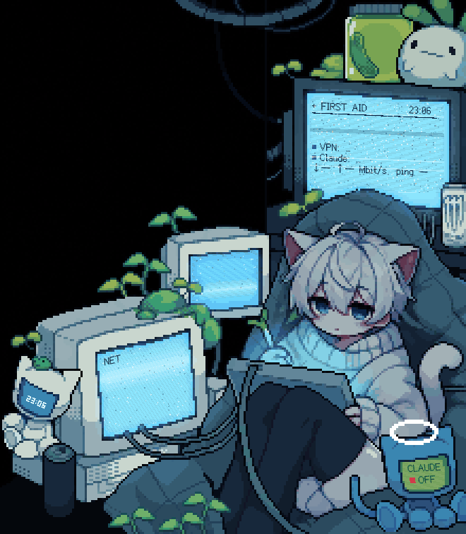
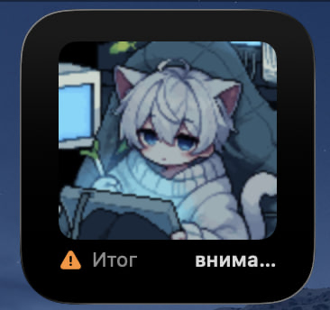
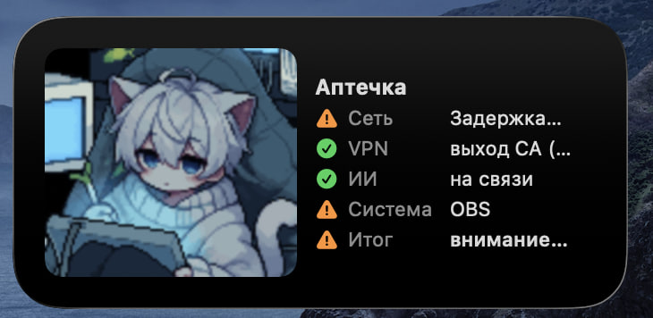
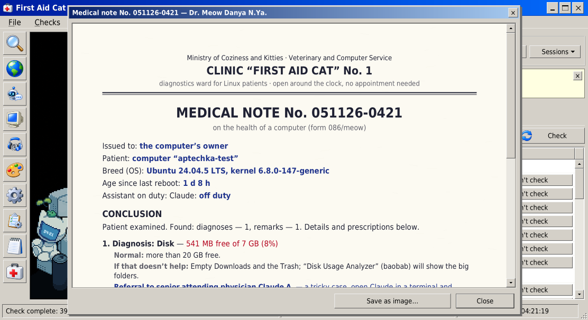

<h1 align="center"><i>CUTE BUT USELESS</i></h1>

<p align="center">
  
  
  
  
  <a href="../../actions/workflows/ci.yml"></a>
</p>

<p align="center">
  
</p>

These days everyone checks their computer by asking a terminal AI agent, and so did I. Then one day the internet stopped working, and nothing I tried would bring it back. Once I'd fixed it, I wrote a small script that would rescue me next time and get me back to the quiet harbour of the all-knowing AI. The project grew into something much bigger, and now it runs on all the major platforms.

**First Aid Cat** (in Russian, *Аптечка*) is a desktop health checker with a doctor cat. It watches the things that usually break at the worst moment: the network, the VPN and its leftovers, proxies, the connection to AI assistants, disks, memory, updates, themes and drivers. It explains what is wrong in plain words, and it offers a fix only where a fix is safe.

It is a single native binary written in Rust. There is no Electron and no GTK. It works offline, and its interface is available in English and Russian.

<p align="center">
  
</p>

## Contents

- [Meet the cat](#meet-the-cat)
- [What it checks](#what-it-checks)
- [Fixes](#fixes)
- [Widgets](#widgets)
- [Install](#install)
- [Command line](#command-line)
- [Languages](#languages)
- [Privacy](#privacy)
- [Architecture](#architecture)
- [Building from source](#building-from-source)
- [Documentation](#documentation)
- [License](#license)

## Meet the cat

The doctor cat is alive. He breathes, blinks, types on his laptop, and the little monitors around him show your real network, CPU and AI status, with a speedometer needle while a speed test runs.

He also reacts to you:
- **pull an ear**, and he blushes and presses his ears down;
- **poke the tail**, and he gets nervous: a drop of sweat, the tail freezes;
- **poke his head**, and he is indignant: ears back, the tail lashes;
- and he has something to say about each of these.

The window, the widgets and the cat make a cozy pixel-art corner for your desktop. He is at home in a customised desktop setup and in background shots for vibey videos and TikToks. What he shows on screen is not saved anywhere: see [Privacy](#privacy).

## What it checks

The checks are grouped into tabs. Each one can be switched off in the **Metrics** tab.

| Tab | What it looks at |
|---|---|
| **Network** | Internet and DNS, including a live DNS query; a system proxy left behind by a VPN that is off; proxies in browsers, extensions, the terminal, git, npm, pip and apt; VPN tunnels and the address the world sees; network latency and jitter; captive portals (cafe and hotel sign-in pages); Wi-Fi signal |
| **AI** | Whether Claude, Codex, Gemini CLI, Qwen Code, Kimi Code, Cursor, OpenCode and Antigravity can reach their servers; the status pages of those services; which agent sessions are alive in your terminals, and the command to resume one |
| **Graphics** | What draws the screen, the NVIDIA driver and Secure Boot, GPU temperature and load |
| **Devices** | Sound and microphone, Bluetooth, printing (paused printers, stuck queues), keyboard layouts, battery wear, disk health (S.M.A.R.T.) |
| **Themes** | Broken themes and icons, GNOME extensions, a dock that vanished after a full-screen window |
| **System** | Clock accuracy and time sync, free space and inodes, memory pressure, failed services, interrupted package installs, Windows Update errors, crashes and freezes, resource-hungry apps, duplicate files |
| **Digital footprint** | What a trojan running as you could take: API keys in shell history, in AI chat logs and in config files; VPN credentials; SSH keys without a passphrase; app login tokens; whether the disk is encrypted. Only the kind of secret and the file are shown, never the secret itself |

A speed test (download, upload, ping) runs only when you ask for it.

## Fixes

Rows with a known remedy have a button. Before anything runs, every action goes through a single validation gate. Actions that need administrator rights ask the system for them (pkexec, UAC or the macOS password dialog) and run in a restricted sandbox.

Examples of fixes:

- turn off a proxy left behind by a VPN;
- restart a VPN client that hangs;
- flush the DNS cache;
- re-enable a paused printer and clear a stuck queue;
- restore the dock;
- reset the Windows Update components;
- empty the trash and thumbnail cache;
- move exact duplicate files to the trash (only after a byte-by-byte comparison);
- lock credential files so other users can't read them;
- remove lines with keys from your shell history.

Every fix also shows the equivalent manual command. You can try any fix without changing anything by setting `DRY_RUN=1`.

A problem that doesn't matter to you can be ignored: **Ignore** next to the row, or **Ignore all** in the header of the Action column. Ignored problems stop counting, so the total turns calm and the cat stops worrying. Ignoring lasts until the app restarts, and if a new problem appears in the same category, you get a desktop notification.

## Widgets

A small desktop widget shows the essentials: network, VPN, AI, CPU and disk. Click it to open the main window. Pick its look and size in the **Widget** menu.

The cat in the **Window** and **Monitor** widgets is alive too: he blinks, the heart bubble bobs, sparks twinkle, and you can pull his ear to make him blush. On Linux the animation sleeps while other windows cover the widget.

| Look | Medium | Small |
|---|---|---|
| **Window** |  |  |
| **Monitor** |  |  |
| **Glass** | — |  |

On **macOS** the widget is a native WidgetKit widget (small and medium). Add it through *Edit Widgets* on the desktop. It is in full color while the desktop is in front, and macOS turns it pale when windows cover it.

| Size | In color | Pale |
|---|---|---|
| **Small** |  |  |
| **Medium** |  |  |

<p align="center">
  
</p>

**Help → Medical Note from Dr. Meow** turns the current state into a (joking) clinic certificate that you can save as an image.

## Install

Download the installer for your system from [Releases](../../releases). Every file is listed in `SHA256SUMS.txt`.

| System | Installer | How |
|---|---|---|
| **Linux**, Debian and Ubuntu | `first-aid-cat_0.9.2_amd64.deb` | `sudo apt install ./first-aid-cat_0.9.2_amd64.deb` |
| **Linux**, Fedora and openSUSE | `first-aid-cat-0.9.2-1.x86_64.rpm` | `sudo dnf install ./first-aid-cat-0.9.2-1.x86_64.rpm` |
| **Linux**, any distribution | `first-aid-cat-0.9.2-linux-x86_64.AppImage` | `chmod +x` it and double-click. Needs FUSE; without it run `./first-aid-cat-0.9.2-linux-x86_64.AppImage --appimage-extract-and-run` |
| **Windows** 10 and 11, x86-64 | `first-aid-cat-0.9.2-windows-x86_64-setup.exe` | Double-click. Installs for your user only, no administrator rights needed. The binary is not signed yet, so SmartScreen may warn about an unknown publisher |
| **macOS** 14 Sonoma or later, Apple silicon | `first-aid-cat-0.9.2-macos-arm64.dmg` | Open it and drag the app to *Applications*. The app has an ad-hoc signature, not a Developer ID, so macOS blocks the first launch: open *System Settings → Privacy & Security* and click *Open Anyway* (on older macOS, right-click the app and choose *Open*) |

Linux packages need glibc 2.35 or newer (Ubuntu 22.04+, Debian 12+, Fedora 36+) and X11 or XWayland. The package installs the `aptechka` command, a menu entry and an icon; it does not start anything at login.

### Portable archives

The same programs without an installer, if you prefer that.

**Linux**:

```sh
tar xf first-aid-cat-0.9.2-linux-x86_64.tar.gz
cd first-aid-cat-0.9.2-linux-x86_64
./install.sh              # installs to ~/.local/bin, adds a menu entry and starts the widget at login
./install.sh --no-widget  # same, without the widget at login
./install.sh --uninstall
```

**Windows**: unpack `first-aid-cat-0.9.2-windows-x86_64.zip` and run `install.cmd`, or just start `aptechka.exe`.

**macOS**: unpack `first-aid-cat-0.9.2-macos-arm64.zip` and move the app to *Applications*.

## Command line

```text
aptechka                 open the window
aptechka --diag          all checks as a table in the terminal
aptechka --sessions      AI agent sessions and how to resume them
aptechka --speed         speed test in the terminal
aptechka --widget        only the desktop widget (Linux, Windows)
aptechka --fix ID [ARG]  run one fix; DRY_RUN=1 shows what would happen
```

## Languages

The interface follows the system language: Russian on a Russian-language system, English otherwise. You can switch it in **View → Language**. The environment variable `APTECHKA_LANG=en|ru` overrides both.

## Privacy

First Aid Cat has no accounts, no telemetry and no analytics. Everything it finds stays on your computer, and it keeps no long-term history of measurements. While it runs, the latest results sit in a private temporary session folder (in memory on most Linux desktops, on disk on Windows and macOS); the app removes them when it exits normally, and a later start removes anything a crash left behind. To check the network it contacts a few well-known public endpoints (connectivity checks, DNS, the status pages of AI services, and IP lookup). [PRIVACY.md](PRIVACY.md) lists every address and every file the app writes.

## Architecture

The program is a single Rust binary:

- winit window, software rendering through softbuffer;
- its own small widget toolkit and text renderer;
- a background scheduler that runs checks in parallel with timeouts and caches the results for the widget;
- a fix engine with one validation gate and a sandboxed elevation path.

[ARCHITECTURE.md](ARCHITECTURE.md) has the module map.

## Building from source

You need Rust 1.85 or newer. All commands below start from the repository root (the folder that contains `engine/`, `packaging/` and `macos/`).

**Build and test** (any system):

```sh
cd engine
cargo build --release
cargo test --release
python3 ../tools/i18n.py check
cd ..
```

The last check confirms that every user-visible string has a translation. The program is `engine/target/release/aptechka` (`aptechka.exe` on Windows).

**Linux packages.** First build the program as above, then run one of these from the repository root:

```sh
packaging/dist.sh linux
```

That makes a portable `.tar.gz`. For other formats run instead `packaging/dist.sh deb`, `packaging/dist.sh rpm` (needs `rpmbuild`) or `packaging/dist.sh appimage` (downloads a pinned `appimagetool`). Results go to `dist/`.

**Windows, cross-built on Linux** (needs `mingw-w64` and the Rust target `x86_64-pc-windows-gnu`):

```sh
rustup target add x86_64-pc-windows-gnu
cd engine
cargo build --release --target x86_64-pc-windows-gnu
cd ..
packaging/dist.sh windows
```

That makes a portable `.zip`. The setup `.exe` is built on Windows with Inno Setup from `packaging/windows/first-aid-cat.iss` (see [release.yml](.github/workflows/release.yml)).

**macOS** (needs Xcode: `xcode-select -s /Applications/Xcode.app`):

```sh
macos/build_app.sh
packaging/dist.sh dmg
```

The first command builds the program itself and makes `macos/build/First Aid Cat.app` with the WidgetKit widget inside. The second packs it into a `.dmg` in `dist/`. Use `packaging/dist.sh macos` instead for a `.zip`.

Every push is checked by [CI](.github/workflows/ci.yml) on Linux, Windows and macOS. A version tag (`vX.Y.Z`) builds and publishes a release for all three systems ([release.yml](.github/workflows/release.yml)).

## Documentation

- [ARCHITECTURE.md](ARCHITECTURE.md) — how the code is organised
- [SECURITY.md](SECURITY.md) — security model and how to report a vulnerability
- [PRIVACY.md](PRIVACY.md) — what is read, what is sent, what is stored
- [TESTING.md](TESTING.md) — how changes are tested
- [AGENTS.md](AGENTS.md) — notes for AI coding agents working on this repository

## License

The **source code** is licensed under the [Apache License 2.0](LICENSE).

The **images** are not covered by that licence. This includes the cat character, the background art, the widget art, the icons and every other picture in the program and in this repository. Using them outside this program is **not permitted**. See [LICENSE-ART.md](LICENSE-ART.md), [NOTICE](NOTICE) and [THIRD_PARTY_NOTICES.md](THIRD_PARTY_NOTICES.md).
